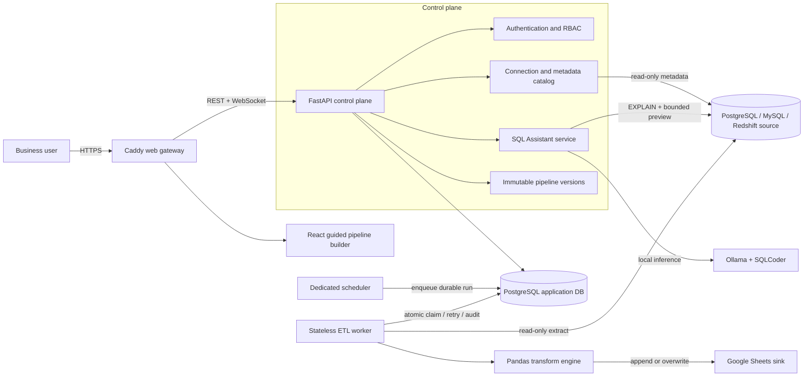

# FlowForge — Automated ETL and SQL Assistant

FlowForge is a FastAPI and React application for creating, saving,
running, and scheduling database-to-Google-Sheets pipelines.

## Features

- Drag-and-drop pipeline canvas with Credential, Extract, Transform, and Sink nodes
- Guided starter flow for users who do not want to begin with a blank canvas
- PostgreSQL, MySQL, and Amazon Redshift connection checks
- Selected-table or custom-query extraction with optional expected-column validation
- Per-schedule incremental extraction using an integer primary key or unique timestamp checkpoint
- Transient Google Sheets API retries and append-header validation
- Encrypted server-side connection profiles; saved passwords are never returned to the browser
- Versioned database metadata catalog with tables, columns, primary keys, and relationships
- Plain-English SQL Assistant powered by a local Ollama model
- SQLGlot AST policy checks, catalog allowlists, `EXPLAIN`, row limits, and read-only execution
- Query preview and full pipeline execution
- Google Sheets output
- Saved editable pipelines
- Database-backed login and role-based permissions
- Argon2id password hashing, legacy-hash migration, and database-backed login throttling
- Encrypted saved credential passwords
- Immutable pipeline versions; schedules remain pinned to the reviewed version
- Per-pipeline schedules, upcoming run times, and run logs
- Browser URLs that restore saved pipelines after reload

## Project Structure

```text
Job_Scheduler/
|-- .gitignore                   Local and generated file exclusions
|-- requirements.txt             Python dependencies
|-- api/                         FastAPI routes, persistence, execution, scheduler
|-- src/                         Shared database and Google Sheets helpers
|-- migrations/                 Reproducible Alembic application DB migrations
|-- Dockerfile.api              API, scheduler, worker, and migration image
|-- docker-compose.yml          PostgreSQL + API + scheduler + worker + Ollama + web
`-- UI/                          React/Vite frontend and Caddy deployment
```

## Production Architecture



The browser never receives saved database passwords. The API is the policy
boundary for connection ownership, catalog access, SQL approval, and pipeline
versioning. Scheduling only enqueues a pinned pipeline version; independently
scalable workers claim runs atomically and record every attempt in PostgreSQL.
This separation keeps the editor responsive and prevents a web-process restart
from losing queued ETL work.

The application also expects runtime configuration, an application database,
and Google credentials to be provided by the environment where it is installed.
Detailed trust boundaries, execution semantics, scale decisions, and trade-offs
are documented in [`docs/ARCHITECTURE.md`](docs/ARCHITECTURE.md).

## Configuration

`Job_Scheduler/.env` is the only env file used by both the backend and frontend.
The provided file contains only safe defaults and blank secret fields. Do not
place real credentials or production secrets in this file.

Operating system, CI/CD, or hosting-platform environment variables take
precedence over values in `.env`.

Before starting the backend, set these required secrets:

```powershell
$env:PASSWORD_PEPPER = python -c "import secrets; print(secrets.token_urlsafe(48))"
$env:APP_SECRET_KEY = python -c "import secrets; print(secrets.token_urlsafe(48))"
```
