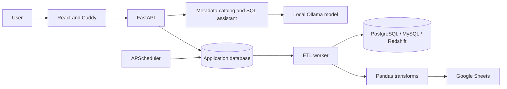

# FlowForge

**Automated ETL pipelines and a metadata-aware SQL assistant**

FlowForge moves data from PostgreSQL, MySQL, or Amazon Redshift into Google Sheets. Build a pipeline on a visual canvas, extract a table or the result of a read-only SQL query, apply Pandas transformations, and run it on demand or on a schedule. A local SQL assistant can propose queries from database metadata for review before they are used.

## Public portfolio deployment

The public Render deployment uses **the same React Flow editor, FastAPI execution engine, saved pipeline/version models, and APScheduler run queue** as the private application. `Dockerfile.public` builds the UI and serves it from FastAPI. `scripts/serve_public.py` applies Alembic migrations, initializes synthetic data, and starts the service.

Choose **Run the sample pipeline** to open a limited sandbox session. Preview or edit the `orders` SQL, adjust a structured transform, run the graph, save a copy, and download server-written CSV from the destination panel. The dashboard and runtime logs read actual persisted job results. The **Run sample scheduled job** control enqueues the same pinned pipeline version used by the scheduler.

This is a shared synthetic sandbox. External database connections, arbitrary expressions, cross joins, and AI SQL generation are disabled in this public mode. Read-only SQLite authorization, query time/row limits, concurrency limits, and bounded saved state keep it suitable for anonymous exploration. The private deployment below retains real database and Sheets adapters.

**Daily hosted job:** `.github/workflows/scheduled-demo.yml` runs daily at 03:30 UTC (09:00 IST), wakes the free web service, enqueues the saved job, checks the actual result, and retains its CSV and run evidence as a GitHub Actions artifact. It can also be dispatched manually. GitHub schedules may be delayed.

**Hosting limits:** Render Free sleeps when idle, has ephemeral storage, and does not provide a continuously running scheduler. Jobs execute while the process is awake; demo state may reset on restart/redeploy. Use a persistent application database and an always-on scheduler/worker for durable production automation. No user credentials or private datasets are included.

Local public build:

```bash
cd UI
npm ci
VITE_PUBLIC_DEMO=true npm run build
cd ..
python -m pip install -r requirements.txt
PYTHONPATH=. python scripts/serve_public.py
```

## Run it locally with Docker (one command)

```bash
cp .env.example .env      # set LOCAL_ADMIN_PASSWORD (12+ chars) and OPENROUTER_API_KEY
docker compose up -d --build
```

Open **http://localhost:8001** and sign in as `admin` with your `LOCAL_ADMIN_PASSWORD`. On first start the `bootstrap` service:

- seeds a demo retail database (200 customers, 1,500 orders, 3,833 order lines) in its own Postgres container,
- creates a read-only role for it,
- registers it as the **Demo retail (PostgreSQL)** connection, and scans its catalog.

In the editor, choose **Create guided pipeline**, pick that connection, ask the SQL assistant a question, then load to a Google Sheet. Without Sheets credentials, use `csv://my_report` as the destination; the files land in `./output/`. Add `--profile mysql` (and uncomment `DEMO_MYSQL_ADMIN_URL`) to also test a MySQL source, or `--profile ollama` to use a local model.

## Evaluation

| Suite | What it measures | Command |
| --- | --- | --- |
| Guardrails | 47 destructive / exfiltration / side-effect statements, both PostgreSQL and MySQL dialects | `python -m eval.run_eval guardrails` |
| NL-to-SQL accuracy | 60 business questions through the real assistant pipeline (catalog context, LLM, guardrails, `EXPLAIN`, self-correction). Correct means the accepted SQL returns the same result set as hand-written gold SQL. | `docker compose exec api python -m eval.run_eval accuracy` |

| Result | Value |
| --- | --- |
| Guardrails (47 statements × 2 dialects) | **47/47 blocked** in both; 0 false positives on normal analytics queries in tests |
| Execution accuracy (60 questions) | see `eval/results/accuracy.json` after running with your key |

The accuracy report also records the model, the drafts allowed, accuracy on the first draft, questions recovered by self-correction, p50/p95 latency, and every failure with its SQL.

## Features

- **Database sources:** Connect to PostgreSQL, MySQL, and Amazon Redshift. Save encrypted connection profiles and scan table, column, primary-key, and relationship metadata.
- **Flexible extraction:** Select a scanned table or enter a custom SQL query. Optionally require named columns in the result before loading.
- **Incremental schedules:** Extract rows after an integer primary-key or unique timestamp checkpoint. Checkpoints are scoped to each schedule and Extract node.
- **Transformations:** Use the visual pipeline editor to filter, join, group, pivot, and reshape data with Pandas.
- **Google Sheets output:** Write to one or more tabs in overwrite or append mode. Transient Sheets API errors are retried, and append mode checks the existing header.
- **SQL assistant:** Describe the data you need in plain English. The assistant ranks catalog tables by relevance, sends only that schema context to the model (OpenRouter by default, or local Ollama/SQLCoder), and checks every draft with SQLGlot guardrails and `EXPLAIN`. Rejections and database errors go back to the model, which corrects itself (up to 3 drafts). Previews apply a row limit and report truncation exactly.
- **SQL guardrails:** One read-only statement; no writes, DDL, locks, `SELECT INTO`, `COPY`, or session changes; no `pg_*`/advisory-lock/`dblink`/sequence functions; no system catalogs or database-qualified references; assistant queries limited to approved catalog tables. The demo connects through a read-only database role as a second layer.
- **Scheduling and visibility:** APScheduler enqueues runs, workers execute them, and the application records status, row counts, duration, retries, and errors.
- **Access control:** Database-backed login, admin and user roles, encrypted saved passwords, and immutable pipeline versions pinned to schedules.

## Tech stack

| Layer | Technology |
| --- | --- |
| Frontend | React, Vite, React Flow |
| API and workers | Python, FastAPI, Pandas, SQLAlchemy, APScheduler |
| Source databases | PostgreSQL, MySQL, Amazon Redshift |
| Application database | PostgreSQL in Docker; SQLite supported for local development |
| Destination | Google Sheets API via `gspread` |
| SQL assistant | OpenRouter (any OpenAI-compatible LLM) or Ollama/SQLCoder, SQLGlot guardrails, EXPLAIN-based self-correction |
| Deployment | Docker Compose, Caddy, Alembic |

## Architecture



The API handles authentication, connection ownership, pipeline definitions, previews, and SQL approval. The scheduler queues a pinned pipeline version; a worker claims the run, performs the extract and load, and records the outcome. See [Architecture](docs/ARCHITECTURE.md) for trust boundaries and delivery semantics.

## Quick start with Docker Compose

### Prerequisites

- Docker with Compose
- A Google Cloud service account for writing to Sheets
- A source database reachable from the containers

### 1. Configure the application

```bash
cp .env.example .env
mkdir -p credentials
```

Edit `.env` and replace `PASSWORD_PEPPER`, `APP_SECRET_KEY`, and `POSTGRES_PASSWORD` with stable, private values. Keep `ALLOW_UNSAFE_SQL=false`. The Compose file supplies the application database URL and connects the services internally.

Place the Google service-account JSON at `credentials/Sheet_Service.json`, or update `GOOGLE_SERVICE_ACCOUNT_FILE`. Enable the Google Sheets and Drive APIs, then share each destination spreadsheet with the service account email as **Editor**. The `credentials/` directory and `.env` are gitignored.

### 2. Start the services

```bash
docker compose up -d --build
docker compose exec ollama ollama pull sqlcoder:7b
docker compose exec api python -m scripts.create_user admin --display-name "Administrator" --role admin
```

The user-creation command prompts for a password. Open **http://localhost:8080** after the services are healthy. The `migrate` service applies Alembic migrations before the API, scheduler, and worker start.

The Ollama download is needed for natural-language SQL generation. To use the limited fallback instead, set `SQL_ASSISTANT_PROVIDER=heuristic` in `.env` and restart the API. The ETL application does not depend on a model download.

## Local development

Requires Python 3.11+, Node.js 18+, and npm. This example uses SQLite for application state; PostgreSQL is recommended for a multi-process deployment.

```bash
cp .env.example .env
```

For local development, set these values in `.env`:

```dotenv
DATABASE_URL=sqlite:///app.db
APP_CORS_ORIGINS=http://127.0.0.1:5173,http://localhost:5173
OLLAMA_BASE_URL=http://127.0.0.1:11434
RUN_EMBEDDED_SCHEDULER=true
```

Also replace `PASSWORD_PEPPER` and `APP_SECRET_KEY` with stable secrets. Then install dependencies, create the database schema and first user, and start the API:

```bash
python3 -m venv .venv
source .venv/bin/activate
python -m pip install -r requirements.txt
touch app.db
python -m alembic upgrade head
python -m scripts.create_user admin --display-name "Administrator" --role admin
python -m uvicorn api.app:app --reload --host 127.0.0.1 --port 8000
```

In a second terminal:

```bash
cd UI
npm ci
npm run dev
```

Open **http://127.0.0.1:5173**. To use the local SQL model, run `ollama pull sqlcoder:7b` and `ollama serve`. Set `SQL_ASSISTANT_PROVIDER=heuristic` if Ollama is unavailable.

## Build a pipeline

1. Add a **Credential** node, enter a PostgreSQL, MySQL, or Redshift connection, and check it. Save the connection securely to enable the metadata catalog and SQL assistant.
2. Add an **Extract** node. Select a scanned table or enter a read-only SQL query. Set **Expected Columns** if the load should stop when required columns are absent.
3. Connect any **Transform** nodes, then add a **Sink** node with a Google Sheet URL or ID, tab names, and a write mode.
4. Preview nodes, run the pipeline, and save it. Saved pipelines can be reopened from their URLs.
5. Open **Pipelines** to create a one-time or recurring schedule. Scheduled runs use the saved, pinned pipeline version.

### Incremental extraction

Choose **Integer primary key** or **Unique timestamp** in the Extract node, enter the checkpoint column, and set every Sink node to **Append rows**. Save the pipeline and create a schedule. The first scheduled run reads the full result; later runs select rows with checkpoint values greater than the last successfully loaded value. Previews do not advance checkpoints, and direct interactive runs of incremental pipelines are rejected.

The checkpoint column must be present, non-null, and increasing. Integer primary keys and timestamps that are unique within each batch are supported. Rows arriving later with a checkpoint at or below the saved value are skipped. Avoid overlapping runs of the same incremental schedule.

Google Sheets and the application database cannot commit together. If a worker stops after writing to Sheets but before saving its checkpoint, a retry may append duplicate rows. Use a stable key and downstream deduplication when duplicates are unacceptable.

### SQL assistant

With a saved connection, scan its schema in the Extract node, describe the data you need, and generate a candidate query. Review the SQL and its bounded preview before selecting **Use this SQL**. The assistant validates the SQL structure and referenced tables; its preview uses `EXPLAIN` and a result limit. Use a read-only source database account as the final permission boundary.

## Configuration

The template is [.env.example](.env.example). Common settings are:

| Variable | Purpose |
| --- | --- |
| `DATABASE_URL` | SQLAlchemy URL for application state; Compose overrides this with its PostgreSQL service URL. |
| `PASSWORD_PEPPER` | Stable secret for password hashes. Changing it invalidates existing passwords. |
| `APP_SECRET_KEY` | Stable secret for encrypted connection passwords. Changing it prevents decryption of saved credentials. |
| `POSTGRES_PASSWORD` | Password for the Compose PostgreSQL service. |
| `GOOGLE_SERVICE_ACCOUNT_FILE` | Service-account JSON path, relative to the project root. |
| `GOOGLE_SHEETS_MAX_RETRIES` | Additional attempts for transient Sheets API errors; default `3`. |
| `SQL_ASSISTANT_PROVIDER` | `ollama` or `heuristic`. |
| `OLLAMA_BASE_URL`, `OLLAMA_SQL_MODEL` | Local model endpoint and model name. |
| `PREVIEW_SQL_LIMIT` | Maximum rows requested for an Extract preview. |
| `ALLOW_UNSAFE_SQL` | Keep `false` to enforce read-only manual Extract queries. |
| `RUN_EMBEDDED_SCHEDULER` | `true` for local single-process use; Compose sets `false` and runs separate services. |
| `APP_CORS_ORIGINS` | Allowed browser origins when the frontend runs separately from the API. |

`VITE_*` settings are read when the frontend is built. Operating-system or deployment environment variables take precedence over `.env`.

## Tests

```bash
python -m pip install -r requirements-dev.txt
python -m pytest -q
cd UI && npm ci && npm run build
```

The tests cover SQL guardrails, credentials, pipeline behavior, incremental checkpoints, and the Sheets append header check. Real database connections, the Ollama model, and the Google Sheets API require separate integration testing with your own services.

## Project layout

```text
api/          FastAPI routes, pipeline execution, authentication, scheduler, worker
src/          Configuration, Pandas transformations, Google Sheets loader
UI/           React/Vite frontend and Caddy configuration
migrations/   Alembic application database migrations
tests/        Backend tests
docs/         Architecture notes
```
