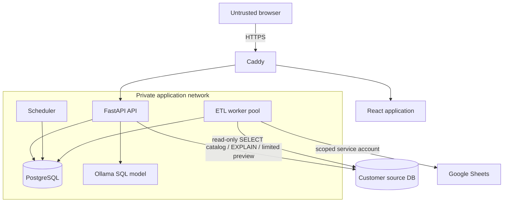
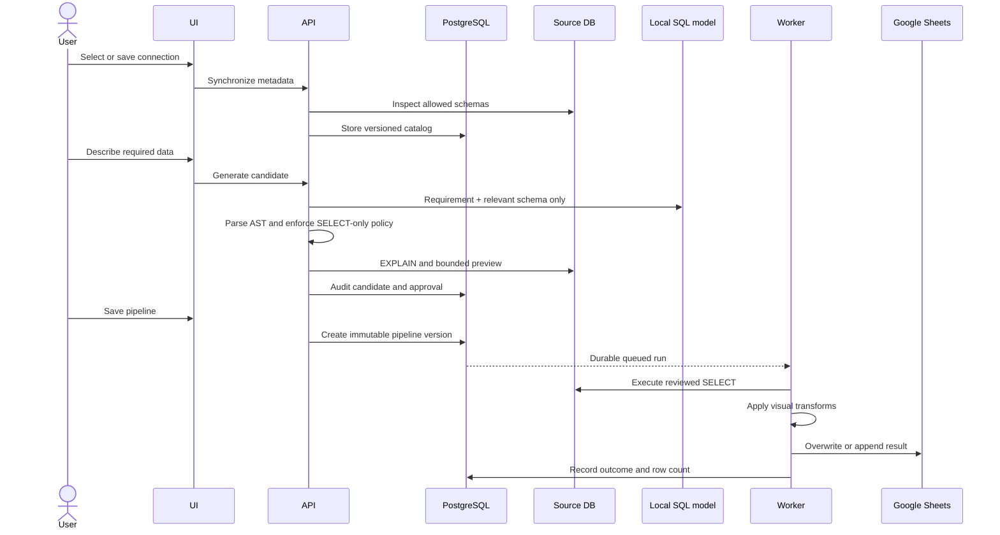

# FlowForge Architecture

## Product intent

This product lets a non-technical user create a controlled database-to-Google-
Sheets ETL pipeline without writing SQL. The user chooses a saved source,
describes the required dataset in plain English, previews the generated query,
adds visual transforms, selects a Sheet destination, and saves a versioned
pipeline. Scheduling is deliberately a separate execution concern rather than
the centre of the product.

The primary deployment profile is self-hosted and license-free. It uses React,
FastAPI, PostgreSQL, SQLGlot, Ollama/SQLCoder, APScheduler, and Caddy. It does
not require a paid database or a paid AI API.

## Context and trust boundaries



The browser is not trusted with stored source passwords, the encryption key, or
Google credentials. Database credentials are encrypted at rest and decrypted
only in API preview operations or worker execution. Source accounts should be
read-only and restricted to approved schemas.

## Control plane and data plane

| Plane | Responsibilities | Scaling model |
| --- | --- | --- |
| Control | Login, RBAC, connection profiles, metadata scans, SQL generation and approval, pipeline editing and versions | Add stateless API replicas behind the gateway |
| Orchestration | Calculate due schedules and create a unique durable run record | Run one active scheduler; the database uniqueness constraint prevents duplicate scheduled runs |
| Data | Claim run, extract, transform, load, retry, and publish run status | Add stateless workers; conditional database updates provide atomic claims |
| State | Users, encrypted connections, catalogs, candidate SQL, versions, schedules, attempts, and audit data | PostgreSQL with backups; managed PostgreSQL can replace the container without application changes |

Separating these planes prevents long extracts from consuming API capacity and
allows workers to scale independently from interactive users.

## Pipeline lifecycle



## SQL Assistant safety pipeline

The model is a proposal generator, not a database authority:

1. The catalog service retrieves table, column, key, and relationship metadata.
   Row values are not added to the model prompt.
2. A relevance pass selects only the catalog tables related to the user request.
3. SQLCoder runs locally through Ollama; a limited deterministic fallback is
   available when the model is disabled.
4. SQLGlot parses the output as an AST. Multiple statements, writes, DDL,
   administration commands, locks, comments used for statement smuggling, and
   unsafe functions are rejected.
5. Every referenced table must exist in the approved metadata snapshot.
6. The source validates the plan with `EXPLAIN`; previews are wrapped in a
   server-controlled row limit.
7. The user explicitly approves the candidate before it becomes node SQL. The
   request, catalog version, candidate, validation result, and approval are
   retained for audit.

These controls reduce risk but do not replace source-side least privilege. A
read-only source user is the final security boundary.

## Reliability and delivery semantics

- A schedule is pinned to an immutable pipeline version. Later edits cannot
  silently change an already reviewed schedule.
- Due work is first committed as a durable run record. Workers conditionally
  update that record to claim it, so multiple worker replicas cannot normally
  execute the same queued attempt.
- Abandoned claims are recovered, and transient failures use bounded
  exponential retries.
- Every attempt exposes status, timestamps, worker identity, errors, and rows
  written through the run log APIs.
- The effective delivery guarantee is **at least once**. The default Google
  Sheets `overwrite` mode is naturally safe to replay for the same input.
  `append` mode can duplicate rows if a process dies after writing but before
  recording success, because Google Sheets cannot participate in a PostgreSQL
  transaction. Business-critical append pipelines should include a stable key
  and downstream deduplication, or use an idempotent warehouse sink.

## Security controls

- Argon2id password hashing with a server-side pepper; legacy PBKDF2 hashes are
  upgraded after a valid login.
- Database-backed login throttling without deleting the audit trail.
- Random hashed bearer-session tokens with expiry and revocation.
- Role and ownership checks on connections, SQL candidates, pipelines, and
  schedules.
- Fernet encryption for saved source passwords; secrets are omitted from API
  responses and local browser persistence.
- Strict CORS configuration, health/readiness endpoints, non-root containers,
  private Compose networking, and no source database port exposure.
- Schema allowlists, read-only source credentials, AST query enforcement,
  `EXPLAIN`, preview limits, and explicit SQL approval.
- Secrets remain deployment configuration and are excluded from source control.

For a public internet deployment, place TLS and rate limiting at the edge,
rotate all secrets that have ever been shared, restrict database firewall rules,
back up PostgreSQL, and monitor failed runs and disk usage.

## Zero-cost deployment profile

```text
One ARM64 Linux host
├── Caddy: static UI, TLS, API/WebSocket reverse proxy
├── FastAPI: control plane
├── Scheduler: one lightweight process
├── Worker: one or more processes within memory limits
├── PostgreSQL: application state and durable queue
└── Ollama + SQLCoder 7B: local text-to-SQL inference
```

All components have free/open-source deployment options. A local machine or an
eligible always-free VM can therefore have a zero monthly software bill. The
trade-offs are limited CPU/RAM, slower model inference, manual backups, possible
free-tier reclamation, and no provider SLA. A domain is optional because an IP
address or free subdomain can be used.

"Production architecture" and "zero cost" are compatible for a portfolio,
demonstration, or small internal workload; they are not equivalent to
enterprise availability. High availability, managed backups, multi-zone data,
on-call alerting, and substantial model throughput eventually require paid
infrastructure or operational labour.

## Scale path without a rewrite

1. Keep the API stateless and add replicas behind the gateway.
2. Increase worker replicas and concurrency while enforcing per-source limits.
3. Move PostgreSQL to managed HA and enable point-in-time recovery.
4. Replace the polling queue with Redis, RabbitMQ, or a cloud queue only when
   throughput justifies the extra operational component.
5. Move large transformations from in-memory Pandas to chunked execution,
   Polars, DuckDB, or Spark based on measured workload size.
6. Add OpenTelemetry traces, Prometheus metrics, centralized logs, alert rules,
   and defined service-level objectives.
7. Add warehouse/object-storage sinks and idempotent staging/merge semantics.

The present design intentionally avoids those costs until usage requires them,
while keeping scheduler, worker, state, model, and gateway boundaries explicit
so each component can be replaced independently.

## Current product boundary

This release supports PostgreSQL, MySQL, and Amazon Redshift sources, Pandas-based
transforms, and Google Sheets sinks. It is suitable for bounded analytical
extracts, not multi-terabyte data movement. Incremental checkpoints are scoped
to schedules and committed after Sheets loads; retries are at least once because
the Sheets API and application database do not share a transaction. Enterprise
follow-on work includes
OAuth/SSO, team/workspace isolation, column-level policy and masking, secrets-
manager integration, catalog refresh policies, data quality assertions,
notifications, lineage visualization, and end-to-end browser tests.
